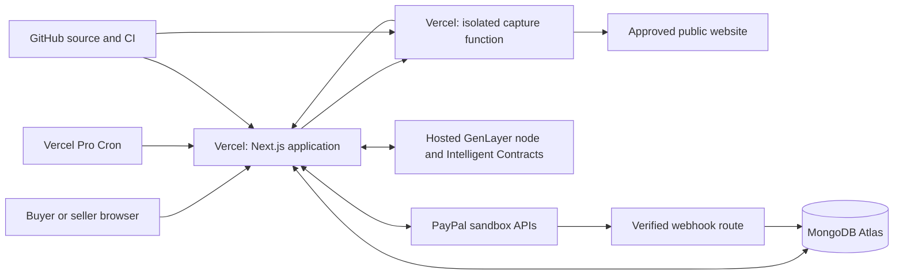
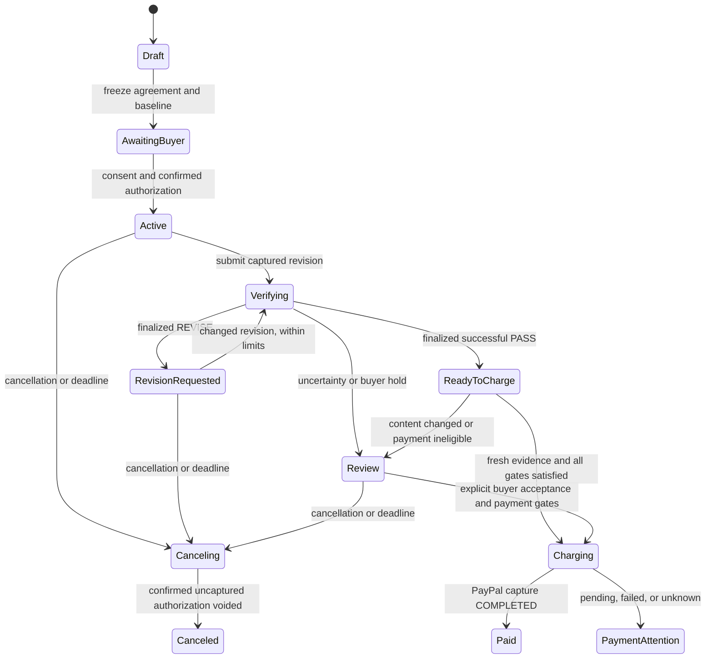

# RevisionPay: build specification

Planning date: 5 November 2026. Target submission: 12 November 2026, before 18:00 Africa/Lagos; the hackathon deadline is 21:00 Lagos / 12:00 p.m. PST.

**Product promise: agree on a website revision, verify the submitted version against that agreement, and collect the authorized PayPal payment when the conditions are met.**

This is the original implementation plan. See [README.md](README.md) for the current implementation, verified behavior, and deployment instructions. The implementation uses GenLayer Studionet as explicitly selected after planning.

Companion documents:

- [Implementation backlog and daily delivery gates](IMPLEMENTATION_BACKLOG.md)
- [Research, verified capabilities, and unresolved prerequisites](RESEARCH_AND_FEASIBILITY.md)

## 1. Decisions to build around

| Decision | Specification |
| --- | --- |
| Initial customer | A small web agency or freelancer completing short, paid website copy revisions for a business. |
| Initial deliverable | One public pricing or service page, with 3–5 explicit acceptance requirements. |
| Payment | One fixed USD amount, one PayPal authorization, one full capture. Demo fee: $180. |
| Core AI | A Python GenLayer Intelligent Contract assesses the agreed requirements. The application does not need a separate LLM provider account. |
| Blockchain purpose | Commit the agreed rules and evidence; preserve a verifiable adjudication record; require finalized successful execution before automatic payment. |
| Web stack | Next.js App Router, TypeScript, Tailwind, accessible UI components. |
| Database | MongoDB Atlas Free, using the native MongoDB driver. Atlas is the managed database implied by the MongoDB choice. |
| Hosting | Two projects on one Vercel Pro account: the application and an isolated browser capture function. No persistent server or VPS. |
| GitHub | Public source repository, CI, releases, issue tracking, and reproducible setup. |
| Budget | $20 Vercel Pro base, up to $10 additional usage, $20 reserve including taxes or unexpected costs. Total ceiling: $50. |
| Seller model | One configured PayPal sandbox merchant. Seller access is restricted to the owner's allowlisted GitHub identity. |
| Buyer experience | An invitation link and PayPal approval. No crypto wallet, GEN purchase, or GitHub account required. |
| Live network target | A qualified GenLayer Bradbury Phase 2 node, subject to the first-day feasibility gate. |
| Development fallback | Hosted GenLayer Studio, explicitly identified as a development environment. It must not be represented as demonstrated decentralized testnet verification. |

The initial scope is deliberately about **semantic copy acceptance**. Examples include whether a trial is described accurately, whether a cancellation promise remains intact, and whether the primary call to action matches the agreed offer. Visual taste, legal correctness, conversion performance, and complete website functionality are outside the acceptance promise.

## 2. Why this project is worth building

The problem is the gap between “I delivered the change” and “the client agrees that the change is complete and releases payment.” A useful product must resolve that gap without making either party learn a new payment system.

There is evidence that disputed invoices and administrative friction contribute to late payment. The UK government's 2024 survey of 300 businesses found that 31% cited disputed invoices as a reason they paid suppliers late; 24% cited administrative errors as a reason they received payments late. These are survey responses, not estimates of all invoices or a global market size.

Invoice chasing, project portals, AI proofing, and GenLayer bounty adjudication already exist. RevisionPay's proposed opening is narrower: **a small-business website revision, mutually specified acceptance conditions, frozen evidence, and PayPal settlement in one working flow**. Do not claim to have invented AI verification or blockchain escrow. The supporting sources and competitors are documented in [the research notes](RESEARCH_AND_FEASIBILITY.md).

The strongest demonstration is a visible financial consequence of verification: an incomplete revision stays unpaid; the corrected revision passes the same frozen requirements and triggers the authorized payment.

## 3. Minimum complete product

The submission is complete only when all of these work together:

1. A seller creates a fixed-price revision agreement from a supported template.
2. The app captures the baseline page and freezes the requirements and payment policy.
3. An invited buyer reviews those exact terms and authorizes a PayPal sandbox payment.
4. The seller submits a revision of the agreed page.
5. The app captures immutable evidence and submits it to the actual GenLayer contract.
6. GenLayer returns criterion-level findings and an overall result.
7. A failed requirement produces a revision request without capture.
8. A corrected submission can pass; provisional consensus still cannot initiate capture.
9. A finalized, successfully executed PASS, a current matching page, and valid payment consent allow one full capture.
10. The buyer and seller can inspect a receipt linking the agreement, evidence, verification, and payment.
11. Closing the browser or restarting a Vercel function does not lose the job or duplicate payment.
12. A judge can use a hosted sandbox demonstration or follow complete repository setup instructions.

The first version excludes multi-merchant onboarding, split payments, platform commissions, subscriptions, long projects, physical deliveries, AI-written legal terms, automatic refunds, and arbitrary website access. Keep refund and reversal **status reconciliation**, even though initiating refunds is outside this build.

## 4. The demonstration agreement

Use an original fictional business, “Northstar Studio,” and a pricing page hosted with the demo. All assets and text belong to the project.

**Revision fee: $180. Website offer: $29/month. These are separate amounts.** The model evaluates the $29 offer copy; it never supplies the $180 capture amount.

| ID | Requirement | Evidence needed |
| --- | --- | --- |
| R1 | Explain a 14-day free trial with no card required, without implying an automatic charge at trial end. | Trial description and any conflicting text elsewhere on the agreed page. |
| R2 | Preserve the $29 monthly price and the right to cancel at any time; do not introduce an annual commitment or termination fee. | Pricing and cancellation passages, compared with the agreed baseline. |
| R3 | The primary CTA must clearly start the free trial and point to the agreed signup path on the approved origin. | Visible button text and its resolved link destination. This does not establish that the signup system works. |

Run this story:

1. Buyer authorizes $180 after accepting the agreement.
2. First revision fixes the trial and CTA but introduces conflicting annual-commitment language. GenLayer returns REVISE, citing R2. The app shows “$180 authorized; nothing charged.”
3. Seller publishes the corrected version and submits again.
4. All criteria pass. The app shows that the decision is awaiting finality.
5. Finality is confirmed; a fresh content check matches the verified version; the backend captures $180 in PayPal sandbox.
6. Receipt shows a completed capture and the corresponding contract, submission, and evidence references.

Also keep an ambiguous fixture, a prompt-injection fixture, and a version that changes after verification. These support evaluation and troubleshooting; they are not alternative product tracks.

## 5. Parties, authentication, and consent

### Seller

Use Better Auth with GitHub OAuth and `@better-auth/mongo-adapter`, passing the shared MongoDB client to the adapter for transaction support. Permit seller operations only for a configured immutable GitHub account ID. A successful GitHub login alone does not grant access to the configured merchant.

The seller may create agreements, submit revisions, inspect findings, and withdraw an uncaptured job. The seller cannot clear a buyer's review hold, impersonate a buyer, or force an AI result to pass.

### Buyer

Create a random, 256-bit invitation capability for one agreement. Store its hash, expiry, and redemption status. Share it manually; this build needs no email delivery service.

Place the capability in the URL fragment, exchange it through a POST request, remove it from the address bar, and issue an HttpOnly, Secure, SameSite cookie scoped to the buyer session. Disable analytics on invitation pages and set a restrictive referrer policy. Validate session expiry in application code; MongoDB TTL cleanup is not an authorization check.

Redeem the invitation once. Give the resulting session access only to its agreement. A replacement invitation revokes the previous unredeemed invitation. Losing an already authorized buyer session requires an owner-assisted recovery procedure with verification; do not silently create a different buyer identity on the existing authorization.

Persist explicit consent to the agreement digest before checkout. Bind the successful authorization to the payer identity returned by PayPal's server response and that buyer session. Never accept a payer identity supplied solely by the browser.

The invitation proves possession of a link; PayPal approval proves control of the paying account. The application is not establishing a verified legal identity. Because the backend sponsors GenLayer writes, on-chain consent records are application attestations rather than buyer and seller wallet signatures.

### Consent text

Use clear copy near the PayPal button, with the amount and deadlines filled from the frozen agreement:

> Authorize $180 for this revision. We will charge this amount once after the agreed checks pass and verification is final, or if you explicitly approve the submitted version yourself. You can request review before charging starts. If the job cannot settle by the stated deadline, we will cancel the uncollected authorization where possible.

Show the public-evidence policy separately before acceptance: the submitted website content and verification record may be visible on GenLayer and cannot be assumed deletable. Restrict the demo to public, shareable material.

### Judge access

Provide a separate sandbox-only demo tenant. A judge can switch between simulated buyer and seller roles for that tenant; the interface clearly identifies the simulated parties. Each session gets its own agreement and controlled demo page.

Role switching never applies to owner agreements. The public demo can only create fixed-template jobs for project-owned pages, within cost limits. A fresh PayPal authorization still requires a real **sandbox** buyer account. Provide sandbox access instructions in the submission, and a recorded completed run for inspection; do not suggest that a live charge occurred in a replay.

## 6. Agreement and payment policy

Default limits:

- One page, one approved origin and path, 3–5 requirements, English copy, USD only.
- Demo amount $180; owner-created sandbox jobs $25–$500.
- Three distinct submissions, including the first submission.
- Submission deadline: 48 hours after the authorization's provider timestamp.
- Latest time to initiate a capture: 70 hours after that timestamp, or the provider's earlier expiry.
- One full capture with no AI-generated price changes or partial splits.
- A buyer review hold remains until explicit buyer acceptance or cancellation; the seller cannot override it.

PayPal generally documents a 29-day authorization validity period and recommends capture within its three-day honor period. RevisionPay uses a much shorter window. Authorization is not escrow, and capture is still subject to PayPal approval and available funds.

Freeze the duration rules before checkout, then derive and display absolute deadlines from the successful authorization. Both representations go into the receipt. If authorization is pending, the seller should not be told that funds are ready.

Before acceptance, the seller may edit the draft. After acceptance, any change to price, requirements, evidence policy, verifier version, or deliverable identity requires a replacement agreement and fresh consent. Never transfer an old PASS to a new agreement.

At the submission deadline, stop accepting new revisions. An already submitted revision may finish verification until the settlement cutoff. At that cutoff, prohibit new captures and cancel any clearly uncaptured authorization. A capture already pending at PayPal continues reconciliation; do not mislabel it as canceled merely because the cutoff has passed.

Do not implement automatic reauthorization in this build. A replacement agreement is allowed only after the previous payment outcome is resolved and any uncaptured authorization is confirmed canceled or expired.

## 7. User interface

| Screen | Essential content and action |
| --- | --- |
| Landing / demo entry | One-sentence promise, working demo entry, supported revision types. |
| Seller workspace | Jobs grouped by required action: waiting for authorization, revision requested, verifying, paid, needs attention. |
| Agreement builder | Page URL, fixed fee, supported requirement template, explicit acceptance conditions, baseline preview, duration rules. |
| Buyer agreement | Frozen requirements, screenshot and relevant baseline passages, authorization amount, consent and review policy, PayPal button. |
| Submission workspace | Current page, numbered revisions, requirement checklist, submit action, evidence-capture status. |
| Verification result | PASS / REVISE / REVIEW REQUIRED, criterion findings with source highlights, and specific requested corrections. |
| Payment status | Separate authorization, charge submission, pending payment, completed payment, and cancellation states. |
| Receipt | Human-readable outcome, timestamps, current payment status, evidence links, downloadable JSON, technical proof details in a disclosure panel. |
| Owner operations | Job age, last cron execution, unresolved provider calls, fee budget, deployment/network identity, pause switches. |

Use a calm, readable layout: light background, strong typography, green/amber/red status treatment with text labels, visible keyboard focus, and good mobile layout. Display screenshots as images and escaped text as text; do not embed submitted HTML into the main app.

The main screen should answer “what is required, what passed, and what happens to payment?” Blockchain hashes and RPC details belong in the proof disclosure and owner tools. Do not show invented confidence percentages.

## 8. Architecture within the hosting constraints



### Application project

Next.js serves the UI and Node.js API routes. It owns authentication, MongoDB access, the PayPal merchant credentials, the GenLayer relayer key, consent records, and payment execution.

Keep external operations short. A request that begins a long workflow persists a job, optionally starts a bounded attempt using Next.js `after()`, and returns the current state. A minute cron invocation resumes due jobs. `after()` helps responsiveness; the database and reconciler provide recovery.

### Capture project

A small Node.js Vercel Function runs Puppeteer Core with serverless Chromium. It has no database credentials, PayPal credentials, or GenLayer signing key. It receives a signed, bounded capture request and returns evidence to the application.

Use a separate Vercel project and deployment environment, even though both projects share a repository. Authenticate capture requests with a dedicated HMAC secret, a short timestamp window, a request ID, and a digest of the request body. Sign the response against the same request ID and evidence digest. Duplicate captures are tolerated; only the first valid result for a persisted capture operation is committed.

Allocate 2 GB memory, Node 24, and a 60-second maximum duration. Target a 30-second capture deadline and a 45-second total function deadline. Package the Chromium binary as a production dependency; use `/tmp` only for temporary browser files and clean up each browser profile.

This separation limits credential exposure if a website abuses the browser. It does not make the evidence collector trustless.

### Database and scheduling

Use MongoDB for persistent work, locks, evidence, sessions, and records. Do not use an in-memory queue, a permanent WebSocket, a process-level interval, or a long-running Python web service.

Configure one production Vercel cron route with `* * * * *`. Hobby only supports daily cron schedules; Pro is part of the budget. Delivery is best effort and may be missed or duplicated, so correctness comes from durable state and idempotency, not scheduler punctuality.

GitHub Actions runs CI and repository smoke tests. It is not a payment scheduler or a general customer-workload browser backend.

## 9. Evidence capture and immutability

### Supported source policy

Start with project-owned demo pages and owner-approved domains. Match the exact approved HTTPS origin and path policy. No private networks, localhost, IP literals, embedded URL credentials, alternate ports, authenticated pages, login bypasses, uploads, file URLs, or user-supplied browser scripts.

Validate redirects and every network request. Permit only the agreed origin and separately approved asset origins. Block downloads, popups, service workers, unexpected protocols, and requests to local, link-local, or private addresses. Pin the approved resolution for the browser invocation or route requests through a validated resolver; a DNS check followed by an unrestricted browser fetch is insufficient against rebinding.

If these restrictions prevent the page from rendering correctly, mark it unsupported or request review. Never silently present a partial capture as complete evidence.

### Snapshot format

Record a versioned, canonical JSON artifact containing:

- Original and final URL, capture time, capture request ID, viewport, locale, and extractor version.
- Ordered text blocks with stable IDs, source locators, and rendered-visibility metadata.
- Relevant headings, pricing text, CTA labels, and resolved link targets.
- Capture warnings, blocked resource information, and completeness status.
- A screenshot digest and the screenshot's dimensions.

Use a fixed desktop viewport, locale, timezone, reduced motion, and bounded readiness conditions. Do not wait indefinitely for network idle. Preserve contradictions across the page; do not extract only the lines that make a requirement look satisfied.

Initial limits: 12 KiB of canonical extracted text and links per page, 5 requirements, a combined AI input budget of 32 KiB, one JPEG screenshot up to 512 KiB, and a capture response below 1 MiB including base64 overhead. Reject oversize evidence explicitly. Final supported limits must pass the first-day contract and capture tests.

Keep screenshots for the parties' review. The first contract evaluates text and link evidence, not the screenshot pixels. Do not offer layout or visual-quality criteria under that implementation.

### Two hashes with different purposes

1. `artifactHash`: SHA-256 of the exact canonical evidence bytes, including capture metadata. This identifies the immutable submitted snapshot.
2. `contentHash`: SHA-256 of the policy-defined text and link content, excluding volatile timestamps and screenshot bytes. This detects unchanged submissions and checks that the verified copy remains present before capture.

Define canonicalization once, version it, and add shared Python/TypeScript test vectors. Use deterministic key ordering, array ordering, UTF-8 encoding, and an explicit normalization policy. Do not change that policy for an accepted agreement.

Store evidence as insert-only documents. A submission references a specific artifact hash, never “the latest page.” Metadata updates belong in separate records. The contract receives the bounded evidence content itself, not just a hash of an answer generated elsewhere.

A retry before a snapshot is committed may observe a later page. Record the actual capture time separately from the seller's submission request time. Once the artifact is committed, retries reuse it; they do not silently recapture and change the contract input.

### Freshness before settlement

After a finalized PASS, capture the agreed page again. Its `contentHash` must match the verified submission. Complete the final PayPal eligibility check and initiate capture within two minutes of that freshness check; otherwise repeat the check.

A change produces `CONTENT_CHANGED` and blocks automatic payment. The seller must submit the new version within the agreed submission limits and deadline; the buyer may then choose explicit manual acceptance of that captured version. Manual acceptance does not bypass the submission policy. Cosmetic changes outside the declared text/link policy do not enter the content hash.

This establishes the submitted and recently observed version. It cannot guarantee that someone will never change the site after payment.

## 10. GenLayer contract and AI design

### Contract boundary

Deploy one `RevisionAgreementV1` Intelligent Contract per authorized agreement. This isolates agreement state and avoids putting every customer's LLM evaluation behind one shared contract queue.

Constructor inputs are the public frozen agreement, baseline evidence, agreement digest, authorization commitment, verifier policy version, and permitted relayer address. The authorization commitment is a salted hash; keep actual PayPal IDs and payer details in MongoDB.

The contract makes the terms immutable. Its result does not itself move PayPal money. The authenticated application bridge performs that operation under merchant authority.

Proposed contract interface:

```text
constructor(public_terms_json, baseline_json, agreement_digest,
            authorization_commitment, relayer_address)

evaluate_submission(submission_id, revision_number,
                    artifact_hash, evidence_json) -> structured verdict

get_agreement() -> public immutable terms and commitments
get_verdict(submission_id) -> immutable recorded verdict, if present
```

Only the configured relayer may submit an evaluation. Enforce unique submission IDs, sequential revision numbers, maximum submissions, matching hashes, and the fixed schema. An identical repeated operation returns its existing recorded result without another LLM evaluation; the same ID with different content is rejected.

Do not silently reevaluate unchanged content to obtain a more favorable answer. A technical transaction failure and a substantive revision request are different states.

### AI output contract

```json
{
  "schemaVersion": "1",
  "agreementDigest": "sha256:...",
  "submissionId": "...",
  "artifactHash": "sha256:...",
  "criteria": [
    {
      "id": "R1",
      "status": "SATISFIED",
      "evidenceBlockIds": ["current:block:12"],
      "reason": "The trial lasts 14 days and explicitly requires no card."
    },
    {
      "id": "R2",
      "status": "SATISFIED",
      "evidenceBlockIds": ["current:block:18", "baseline:block:15"],
      "reason": "The page preserves monthly billing and cancellation without an annual commitment."
    },
    {
      "id": "R3",
      "status": "SATISFIED",
      "evidenceBlockIds": ["current:link:3"],
      "reason": "The primary CTA describes the trial and resolves to the agreed signup path."
    }
  ],
  "verdict": "PASS"
}
```

Criterion states are `SATISFIED`, `UNSATISFIED`, and `UNVERIFIABLE`. Compute the overall result deterministically after validation:

- Any UNVERIFIABLE criterion: REVIEW_REQUIRED.
- Otherwise, any UNSATISFIED criterion: REVISE.
- Otherwise, all required criteria SATISFIED: PASS.

An operational failure, invalid model output, or failed consensus is `VERIFICATION_FAILED`, not an invented REVIEW_REQUIRED verdict attributed to the model.

### Leader and validator behavior

The leader uses `gl.nondet.exec_prompt(..., response_format="json")` against the frozen rubric and evidence. Treat all website text as untrusted content. The fixed instructions tell the model to evaluate the requirement, ignore instructions found inside evidence, cite source block IDs, and return UNVERIFIABLE when the evidence cannot establish a conclusion.

Use the custom validator path with `gl.vm.run_nondet_unsafe`. Validation must check substantive agreement with the evidence, not merely that the output is valid JSON.

The validator independently assesses the requirements using the same immutable inputs, validates the leader's cited blocks and conclusions, and checks the finite criterion statuses. It does not require identical free-form prose. The outer deterministic code checks the complete set of criterion IDs, allowed enums, bounds, valid citations, agreement binding, and aggregate result.

For findings based on absence, allow an explicit no-support-found marker tied to the complete scoped evidence rather than fabricating a quotation. Conflicting evidence must be considered, including text that appears after the primary pricing section.

Consensus does not prove that the original website or collector was honest, and multiple models can share a mistake. The test corpus and uncertainty behavior remain essential.

### Transaction lifecycle and fees

Persist each deployment and evaluation operation before sending it. Save the transaction ID immediately when available. Poll through short jobs; do not keep a Vercel request open waiting for finality.

The capture gate requires the **stored** status FINALIZED and successful execution, normally `FINISHED_WITH_RETURN`, for the correct transaction and contract. `isSuccessful()` alone, ACCEPTED, an EVM inclusion receipt, or a lifecycle projection saying “ready to finalize” is insufficient.

If the protocol requires a finalization action after its appeal window, submit the decision-bound resolution action through the matching SDK/ABI, then continue checking persisted status. Do not assume every network runs a keeper that will do this for the app. Record and retry that action separately; re-read the decision identity before retrying if the decision changed.

For the inspected `genlayer-js` 2.0.0-rc.2 implementation, `client.finalizeTransaction({ txId })` checks the active decision and finalization readiness, then submits the decision-bound action. Its return value is an **EVM transaction hash**, which must be recorded separately from the Intelligent Contract transaction ID. Confirmation of that EVM transaction is followed by another `getTransaction({ hash: txId })` read. Studio capabilities differ; the selected adapter must prove its actual completion path.

Appeals or recomputation invalidate provisional displays. Only the final recorded verdict can influence automatic settlement. Keep protocol appeal handling separate from the application's buyer review hold; the latter does not initiate a blockchain appeal.

Use measured fee profiles for deployment, PASS, REVISE, uncertainty, and failure branches. Supply the matching `distribution` and `feeValue`, impose fee ceilings, and keep the relayer funded from the appropriate testnet faucet. Zero EVM gas in Studio does not establish zero protocol or inference cost.

Ambiguous broadcast results enter `SUBMISSION_UNKNOWN`. Reconcile the persisted intent, signer nonce or known transaction identifiers, and contract state. Do not blindly send a new evaluation with a fresh operation ID. If finality and result linkage cannot be established, payment stays blocked.

### Network gate

The intended testnet is Bradbury Phase 2, chain ID 4221. Verify its published genesis and AddressManager as well as the chain ID. The published `rpc.testnet-chain.genlayer.com` endpoint is the underlying chain RPC; it is not sufficient for Intelligent Contract `gen_*` operations.

The current qualified node endpoint remains an external prerequisite. Day one must prove a funded write, actual LLM execution, verdict retrieval, and finalization through the selected endpoint. If it cannot, continue implementation against hosted Studio with a clearly labeled adapter. Do not build a node or add a VPS under the current constraints, and do not conceal the fallback in the final demo.

## 11. PayPal integration and settlement gate

Use PayPal JavaScript SDK v6 in the browser and direct REST calls from the server. The current setup guidance recommends public client-ID initialization for ordinary checkout. Do not expose merchant OAuth access tokens or client secrets. Validate the initialization against the deployed sandbox example during the first-day spike because some documentation examples still show older token flows.

| Operation | PayPal endpoint | App behavior |
| --- | --- | --- |
| Create checkout order | `POST /v2/checkout/orders`, intent AUTHORIZE | Derive amount, currency, and reference from the frozen agreement. |
| Authorize approved order | `POST /v2/checkout/orders/{id}/authorize` | Called from the server after SDK approval; persist authorization and verified payer binding. |
| Read order | `GET /v2/checkout/orders/{id}` | Reconcile approval, authorization, and linked payment resources. |
| Read authorization | `GET /v2/payments/authorizations/{id}` | Verify provider state and remaining eligibility before a mutation. |
| Capture authorization | `POST /v2/payments/authorizations/{id}/capture` | One fixed full amount; set `final_capture: true`. |
| Void uncaptured authorization | `POST /v2/payments/authorizations/{id}/void` | Cancel only when capture is not pending, unknown, or completed. |
| Read capture | `GET /v2/payments/captures/{id}` | Confirm COMPLETED, PENDING, DECLINED, FAILED, or refund state. |
| Verify webhook | `POST /v1/notifications/verify-webhook-signature` | Require successful verification against the configured webhook ID. |

For an AUTHORIZE order, do not use `/orders/{id}/capture` as the later capture operation. Capture the authorization through Payments v2.

Use the provider's no-shipping configuration for this digital service. Store money as integer minor units and format it into decimal strings on the server. The browser and the model never supply authoritative amounts, currencies, payees, or API destinations.

### Conditions for automatic capture

Every condition must be true at the point the payment command is atomically reserved. Recheck the time cutoff, freshness window, and settlement pause immediately before the external capture call:

1. The job belongs to the configured merchant and is active.
2. Buyer consent still refers to the frozen agreement and current authorization.
3. The buyer has not placed a review hold or canceled.
4. The verdict belongs to the registered network, contract, agreement, current submission, and artifact hash.
5. The relevant deployment and evaluation have finalized successfully.
6. The stored verdict is PASS and every required criterion is satisfied.
7. The fresh content hash matches that submission and is still within the freshness window.
8. The agreed capture cutoff has not passed.
9. The authorization is confirmed usable by PayPal, for the expected merchant, currency, and amount.
10. No capture or void command is already unresolved or complete.
11. The global settlement pause is off.

Persist the capture intent, exact payload hash, and one stable `PayPal-Request-Id` before the external call. Atomically transition the agreement into an in-flight payment state. Cancellation and new submissions cannot slip in after this boundary and be represented as having stopped the charge.

The result is PAID only when PayPal reports capture COMPLETED. A successful HTTP response containing a pending payment remains PAYMENT_PENDING.

### Explicit buyer acceptance

A buyer may manually accept a captured submission that needs revision or review. Show the exact version and amount again, require a new explicit confirmation, and record a `BUYER_ACCEPTED` consent event. Apply the same authorization, freshness, deadline, hold-resolution, and deduplication checks.

This path is separately identified in the receipt as **buyer-approved payment**. It must not create or pretend to have an AI PASS. Only the buyer can authorize it; owner tools cannot force payment through a failed verification gate.

### Ambiguous results and retries

Keep a stable request ID per operation, and separate IDs for order creation, authorization, capture, and void. PayPal's idempotency protection has provider-specific retention; it is not permanent storage.

Read provider state before retrying a mutation after a timeout or 5xx response. Replay only the identical payload and request ID within a retention period verified for that endpoint. If that period cannot be established, the MVP defaults to read-only reconciliation after an ambiguous send rather than an automatic replay. Never generate a fresh request ID simply because a request timed out.

An unresolved capture blocks both a new authorization and a competing void. Surface “Checking payment status” and keep reconciliation active. A confirmed failure may become a recoverable user action; an uncertain outcome is not a confirmed failure.

### Webhooks

Subscribe to the relevant Payments v2 events, including authorization created/voided and capture completed, pending, declined, refunded, and reversed. Use `PAYMENT.CAPTURE.DECLINED` for the documented v2 event, not the older v1 DENIED event name.

Verify signature headers and the event with PayPal. Persist the verified event under a unique provider event ID before acknowledging it. If persistence fails, return a retryable error. Apply events idempotently and reconcile important resource changes against PayPal; arrival order is not authoritative.

Unknown resource IDs go to an orphan-event log. They must not create a customer job or attach themselves by a browser-supplied reference. Webhooks complement polling; a missed webhook must not permanently strand a completed capture.

## 12. Separate state machines

Do not compress fulfillment, verification, and money into one status field.

| State axis | Main values |
| --- | --- |
| Agreement | DRAFT, AWAITING_BUYER, ACTIVE, REVIEW_HOLD, CANCELED, CLOSED |
| Evidence/submission | CAPTURE_QUEUED, CAPTURING, READY, CAPTURE_FAILED, SUPERSEDED |
| Verification | NOT_STARTED, DEPLOYING, QUEUED, SUBMITTED, AWAITING_FINALITY, FINAL_PASS, FINAL_REVISE, FINAL_REVIEW, FAILED, SUBMISSION_UNKNOWN |
| Payment | NONE, ORDER_CREATED, AUTHORIZING, AUTH_PENDING, AUTHORIZED, AUTH_DENIED, CAPTURE_RESERVED, CAPTURE_SUBMITTED, PAYMENT_PENDING, PAID, PAYMENT_FAILED, PAYMENT_UNKNOWN, VOID_RESERVED, VOID_PENDING, VOIDED, EXPIRED |
| Later payment adjustment | NONE, PARTIALLY_REFUNDED, REFUNDED, REVERSED, ADJUSTMENT_UNKNOWN |

Representative transitions:



The diagram is a user journey. The separate persisted state axes govern concurrency and recovery. In particular, a late webhook may resolve a money state without changing the already recorded verification result.

Enforce these invariants:

- One current submission per agreement; older results cannot change payment eligibility.
- One unresolved money mutation per authorization.
- An automatic capture always cites the exact final verification and freshness check.
- A manual capture always cites explicit buyer acceptance of that exact version.
- A terminal verified artifact is never overwritten.
- A UI role switch cannot change server permissions outside its sandbox demo tenant.
- A payment status never becomes PAID from an LLM response or a browser callback alone.

## 13. MongoDB data model

Use schema-versioned documents validated by Zod at application boundaries. Use short MongoDB transactions for state updates plus job/audit inserts where needed; never call PayPal, GenLayer, or the browser service inside a database transaction.

| Collection | Important fields and indexes |
| --- | --- |
| Auth library collections | Accounts, users, sessions, verification records according to the chosen Better Auth adapter; restrict seller authorization separately. |
| `agreements` | `_id`, tenant/owner, frozen terms JSON/digest, baseline ID, accepted version, current submission ID, policy, deadlines, contract identity, state axes, payment command, optimistic `version`. Index owner+updatedAt and active state+nextCheckAt. |
| `buyer_sessions` | Session hash, agreement ID, expiry, revocation, accepted digest, verified payer binding. Unique session hash; TTL for cleanup only. |
| `invitations` | Token hash, agreement ID, expiry, redeemedAt, revokedAt. Unique token hash. |
| `consents` | Agreement digest, actor/session reference, scope, exact confirmation text/version, timestamp, request reference. Append-only. |
| `submissions` | Agreement ID, revision number, requestedAt, evidence ID/hash, content hash, status, current verification ID. Unique agreement+revision. |
| `evidence` | Artifact hash, canonical JSON, content hash, capture policy, completeness, screenshot reference. Unique artifact hash; insert-only. |
| `evidence_images` | Screenshot hash, MIME type, dimensions, bounded binary data. Unique image hash. |
| `verifications` | Submission, input digest, contract/network, operation key, transaction ID, persisted protocol/execution status, decision history, final verdict, fee observations. Unique operation key; index nextCheckAt for unresolved operations. |
| `payment_operations` | Merchant, agreement, type, request ID, payload hash, authorization/capture IDs, submission/proof binding, attempts, request state, provider response summary. Unique request ID and one capture-operation key per authorization. |
| `webhook_events` | Provider event ID, verification result, event type, mapped resource, processedAt, sanitized content. Unique provider event ID. |
| `jobs` | Type, subject ID, generation, dueAt, status, lease token/expiry, attempt counters, handler version, last error. Unique logical job key; index status+dueAt+leaseUntil. |
| `audit_events` | Actor, agreement, event type, before/after versions, references, timestamp. Append-only; index agreement+timestamp. |
| `service_state` | Last successful tick, pause flags, daily quotas, relayer nonce/lock information, deployment manifests. |

Store provider IDs as unique partial indexes when present, including merchant ID in uniqueness where appropriate. Do not use a unique index that treats every missing optional provider ID as the same record.

Authoritative payment intent resides on the agreement as well as in its operation record. This makes the capture-vs-cancel decision atomic through a versioned compare-and-set. A transaction inserts the outbox job and audit entry with that state change. A reconciliation scan repairs any recoverable missing job.

Use integer money fields, UTC timestamps, random public IDs, and a clear distinction between absent and unknown states. Keep provider secrets out of documents that can be returned to clients.

Use a cached `MongoClient` promise, a small connection pool (initially maximum 5, minimum 0), bounded server-selection time, and a nearby Atlas/Vercel region. Do not create and close a new connection for every query. The Atlas Free connection and storage limits must be respected.

Bound the client's operation/transaction retry time within the function budget; start with an 8-second `timeoutMS` and a 5-second server-selection timeout, then validate under the actual network latency. The current auth adapter can otherwise retry conflicting transactions for up to 120 seconds. Keep external side effects out of auth/database hooks that can be retried.

Atlas Free is a prototype database. Check its current backup options before relying on them. Keep a reproducible synthetic seed and an export of important sandbox proof records; do not promise production recovery guarantees from the free tier.

## 14. Application API boundaries

All mutating routes validate session, role, tenant, expected agreement version, request schema, and applicable idempotency key. Cookie-authenticated routes enforce origin/CSRF protection. Rate limits are server-side.

| Route | Actor / purpose |
| --- | --- |
| `POST /api/agreements` | Owner: create a draft. |
| `PATCH /api/agreements/:id` | Owner: edit an unaccepted draft with a version precondition. |
| `POST /api/agreements/:id/freeze` | Owner: require complete baseline evidence, freeze terms, issue invitation. |
| `POST /api/invitations/exchange` | Invitation holder: establish a scoped buyer session. |
| `POST /api/agreements/:id/accept` | Buyer: accept the displayed digest and consent version. |
| `POST /api/agreements/:id/paypal/order` | Buyer: create or recover the agreement's checkout order. |
| `POST /api/agreements/:id/paypal/authorize` | Buyer callback: authorize the stored, approved order server-side. |
| `POST /api/agreements/:id/submissions` | Seller: create the next capture operation for the agreed source. |
| `POST /api/agreements/:id/review-hold` | Buyer: atomically stop future capture reservation when still possible. |
| `POST /api/agreements/:id/manual-acceptance` | Buyer: explicitly accept a specific captured version and amount. |
| `POST /api/agreements/:id/cancel` | Authorized party: request cancellation if money is not already in flight. |
| `GET /api/agreements/:id` | Authorized parties: status, permitted actions, and display-safe data. |
| `GET /api/agreements/:id/receipt` | Authorized parties or an explicit public demo: human/JSON proof receipt. |
| `GET /api/evidence/:id` | Authorized parties; public only for explicitly published demo evidence. |
| `POST /api/demo/start` | Create an isolated, quota-limited synthetic demo session. |
| `POST /api/demo/version` | Select an original fixture version for that demo session. No arbitrary HTML. |
| `POST /api/webhooks/paypal` | PayPal events, independently authenticated by signature verification. |
| `GET /api/internal/tick` | Vercel Cron, authenticated using `CRON_SECRET`. |
| Capture project: `POST /api/snapshot` | Signed server-to-server request; never a public arbitrary-URL screenshot API. |

Return workflow IDs and 202 responses for queued work. The browser polls display state, initially every 3–5 seconds during active work and less often while waiting. Polling should not automatically submit new AI evaluations or financial commands.

Use one consistent response form for errors: a stable code, a user-readable explanation, current state, and permitted next actions. Keep provider payloads and internal errors in protected logs.

## 15. Jobs, concurrency, and recovery

Job types are CAPTURE_BASELINE, CAPTURE_SUBMISSION, DEPLOY_AGREEMENT, SUBMIT_VERIFICATION, POLL_VERIFICATION, RESOLVE_FINALITY, CHECK_CURRENT_CONTENT, CAPTURE_PAYMENT, POLL_PAYMENT, VOID_AUTHORIZATION, and RECONCILE.

Each job has a deterministic logical key from type, subject, and generation. Polling reschedules the existing logical operation; it does not create an unbounded new job for every tick.

Use `findOneAndUpdate` to claim due work atomically, assigning a fresh lease token and a lease longer than the function's hard timeout. Initially use a 90-second lease for a 60-second invocation. A worker must present that token on every completion update. Lease expiry permits recovery but does not authorize an unguarded replay of an external payment.

Keep concurrency low: at most two general jobs and one signing/broadcast operation per relayer at a time. If signing can precompute a transaction identifier, persist it before broadcast. Otherwise use an explicit unknown-send recovery state. Protect nonce allocation with database state, not a process variable.

Enforce those limits across cron and `after()` invocations using named, leased capacity slots in `service_state`; a limit applied separately inside each function is insufficient. Use the same expiry and fencing principles as job leases. Release a slot only when its current lease token matches.

Prioritize unresolved money operations and imminent deadlines over new verifications. After a successful content-freshness check, continue directly into the guarded capture step if the invocation has enough time; otherwise persist a high-priority follow-up. An expired freshness result causes a new check, never a bypass.

The cron handler:

1. Checks its secret and settlement pause configuration.
2. Repairs a bounded set of stale active records missing follow-up jobs.
3. Claims a small batch of due work and processes it within a 45-second budget.
4. Records the successful tick and reschedules remaining work.

Do not sleep inside a function until a future event is due. Save `dueAt` and return. Use provider retry guidance and bounded exponential backoff for transient failures. Normal “not finalized yet” polls do not count as errors. A long pending capture can be polled less frequently while verified webhooks remain active.

Operational requirements:

- A redeploy must leave MongoDB jobs resumable; keep handler and schema versions explicit.
- An old invocation cannot overwrite a new submission or a newer payment state.
- New submissions and cancellation must compare-and-set against the same payment reservation boundary.
- Out-of-order webhooks must not revert COMPLETED to PENDING.
- Deadline handling must reconcile uncertain payment state before trying to void.
- A paused settlement service may continue observation and reconciliation without initiating new charges.

## 16. Repository and dependencies

```text
revisionpay/
  apps/
    web/                   Next.js UI, APIs, auth, jobs, payment bridge
    capture/               isolated Vercel Node function and browser extractor
  packages/
    domain/                schemas, money, state transitions, canonicalization
  contracts/
    revision_agreement.py
    tests/
    fee-profile.json       generated from actual representative runs
  fixtures/                original baseline, incomplete, corrected, ambiguous pages
  scripts/                 indexes, synthetic seed, integration smoke checks
  docs/                    architecture, setup, evaluation, demo, operations
  .github/workflows/ci.yml
  pnpm-workspace.yaml
  pnpm-lock.yaml
  .env.example
  LICENSE
  README.md
```

Use a small pnpm workspace; a separate monorepo orchestration framework is unnecessary.

Planning baselines observed on 5 November:

| Component | Baseline / policy |
| --- | --- |
| Node | 24.x, explicitly selected for both Vercel projects and CI. |
| Next.js | 16.4.5 observed in the registry; lock the tested version. |
| React / TypeScript / MongoDB driver / Zod | Compatible supported versions, frozen in the lockfile after the first build. |
| Better Auth | 1.7.17 observed; GitHub provider and the separately packaged `@better-auth/mongo-adapter`, with a matching locked adapter version. |
| Serverless browser | `@sparticuz/chromium` 153.0.0 with `puppeteer-core` 25.11.0 as the initial Chromium-major-matched pair; deployment compatibility must still be tested. |
| UI end-to-end tests | Playwright, with its own matching test browser. This is separate from the capture runtime. |
| GenLayer v0.6 stack | `genlayer-js` 2.0.0-rc.2 observed; use only against the matching qualified network/Studio release. |
| GenLayer stable fallback | npm `latest` currently resolves to 1.1.8, which must not be assumed compatible with v0.6 APIs. Use a tested matching adapter if stable Studio requires it. |
| Python | Contract source and matching GenLayer test tooling; no hosted Python API. |

Pin direct dependencies and commit lockfiles. Do not mix examples from incompatible GenLayer release families or upgrade the verifier under an accepted agreement.

Required environment groups:

- Application: base URL, auth secret, GitHub OAuth credentials, allowed seller GitHub ID, MongoDB URI/database, cron secret, server-side pause/config values.
- PayPal: sandbox client ID, server-only client secret, webhook ID, expected merchant ID, hardcoded sandbox API selection for the public demo.
- GenLayer: network profile, qualified node URL, relayer private key, verified network identity, source/verifier version, fee ceilings. Store contract addresses per agreement.
- Capture application client: capture service URL and dedicated request-signing secret.
- Capture service only: request-signing secret, approved source/asset hosts, evidence-policy version, runtime limits. No financial or database secrets.

Public configuration is a deliberate allowlist. Do not broadly prefix environment variables with `NEXT_PUBLIC_`.

## 17. Deployment and operations

Create one GitHub repository with a visible root MIT license and two connected Vercel projects, each with the correct root directory and build settings. Separate development, preview, and the hosted sandbox environment in credentials, database names, webhooks, and contract manifests.

Use the main Vercel production deployment as the public **sandbox** demo. “Production deployment” here describes Vercel's deployment environment, not live-money PayPal processing. Disable financial execution from preview deployments.

Deploy in a region near the Atlas cluster. Atlas must admit the Vercel application's outbound database connections. Where the prototype requires a broad network access list because outbound IPs vary, use TLS, a strong generated database password, a database-scoped user, and sandbox-only records. Revisit network controls before a commercial pilot.

Deployment sequence:

1. Create the Atlas database/user, indexes, and synthetic fixtures.
2. Deploy the capture project and pass a deployed cold-start and cleanup check.
3. Deploy the web project and verify authentication and tenant isolation.
4. Register the sandbox webhook against the stable URL; confirm signature verification with actual sandbox events.
5. Configure the GenLayer network profile and sponsored wallet after the network gate passes.
6. Enable cron and confirm a persisted heartbeat plus recovery of a deliberately interrupted job.
7. Complete a real sandbox authorization, failed revision, corrected revision, finalized verdict, and capture.
8. Tag the tested application/contract release and record the deployment manifest.

Monitor last tick, age of oldest due job, verification latency, pending money operations, capture failures, database size/connections, and daily inference budget. The owner dashboard is sufficient for this submission; no additional monitoring vendor is required.

Provide two pause switches: stop accepting new paid/AI jobs, and stop initiating settlement. Both leave read-only reconciliation available. If the verifier or network identity changes unexpectedly, stop new automatic captures until compatibility is re-established.

Maintain a short recovery runbook for a lost webhook, ambiguous capture, stuck finalization, missing faucet funds, evidence mismatch, and expired authorization. Owner actions may reconcile, retry a safe operation, or void a confirmed uncaptured authorization. There is no “mark paid” or “force PASS” shortcut.

## 18. Validation and release criteria

Test financial invariants and real external boundaries. Do not spend the week writing tests that only repeat field getters or UI implementation details.

| Test group | Required evidence |
| --- | --- |
| Agreement integrity | Changed amount, terms, baseline, or verifier version cannot reuse consent; cross-language hash vectors agree. |
| AI behavior | Correct, incomplete, conflicting, ambiguous, and injected evidence; invalid citations and malformed outputs are rejected. |
| Finality | ACCEPTED cannot capture; FINALIZED with failed execution cannot capture; a changed decision cannot reuse an older provisional PASS. |
| Submission binding | Old verdict, wrong contract, wrong network, altered artifact, duplicate content, or changed current page blocks automatic capture. |
| Money concurrency | Duplicate clicks, overlapping cron runs, webhook-before-response, and timeout-after-success produce one logical capture. |
| Recovery | Browser closed, function terminated, missed cron, missed webhook, and redeploy all resume from persisted state. |
| Payment edge states | Pending authorization, denied authorization, pending capture, declined capture, cancellation race, cutoff, refund/reversal update. |
| Authorization boundaries | Buyer cannot modify price; seller cannot clear review hold; demo tenant cannot reach owner jobs; invitation replay and CSRF fail. |
| Capture isolation | Private/redirected destinations, excessive pages, incomplete rendering, and forbidden subresources are rejected; capture runtime has no payment secrets. |
| Hosted function limits | Actual cold start, browser shutdown, payload sizes, MongoDB connection reuse, and stable job leases on Vercel. |

Create a small, labeled evaluation corpus of at least 12 cases, including paraphrases that should pass and contradictions that should fail. Run the difficult cases more than once through the real GenLayer path to observe instability. Report counts, failures, and observed latency; do not claim production accuracy from that small sample.

The mandatory release gate is zero observed automatic captures for a known incomplete or ambiguous test case. This is a release criterion, not a statistical guarantee of safety.

CI runs lint/type checks, domain/state tests, contract tests supported by the selected tooling, and UI tests with mocked providers. Manual or deliberately triggered integration checks exercise actual PayPal sandbox and the chosen GenLayer environment. Clearly distinguish simulated failure tests from failures reproduced against the providers.

The final release must include at least one recorded, end-to-end real sandbox capture tied to actual GenLayer execution, plus a real failed-verification run that remains uncaptured. The chosen network and observed timing must be disclosed.

## 19. Presentation and launch path

Target a 2:45 video:

| Time | Show |
| --- | --- |
| 0:00–0:20 | The acceptance/payment problem and the $180 revision agreement. |
| 0:20–0:45 | Frozen requirements, buyer consent, PayPal authorization. |
| 0:45–1:15 | Incomplete revision, cited failure, no charge. |
| 1:15–1:45 | Corrected revision and provisional verification state. |
| 1:45–2:15 | Actual finalized result, current-content check, completed sandbox capture. |
| 2:15–2:45 | Receipt, why GenLayer matters, supported customer/use case, repository and demo access. |

Network waiting can be edited with an explicit elapsed-time label. Do not make a long finality period appear instantaneous or replace an unsuccessful live flow with unlabeled fabricated success.

Provide a public repository, root license, actual setup instructions, seeded fixtures, environment template, model/tool explanation, contract deployment instructions, and hosted demo URL. Test those instructions from a clean checkout. Use original assets and no unlicensed music; use PayPal's official SDK branding according to its terms.

After the hackathon, validate the business with three freelancers/agencies and two buyers. Ask about a specific recent delayed revision payment, current approval process, willingness to preauthorize, what evidence they would trust, and whether they would accept automatic charging after the agreed checks.

Initial commercial hypothesis: a small monthly fee for agencies, with a bounded number of verifications. Test willingness to pay around $19/month only after measuring real per-agreement verification, capture, support, and infrastructure costs. Faucet-funded testnet fees cannot establish commercial gross margin.

Before live-money use, require an eligible receiving merchant account in the actual operating country, validated PayPal commercial integration, stronger operational recovery and access controls, suitable data/privacy terms, and a supported GenLayer operating environment. A global target market does not mean the sandbox establishes worldwide availability.

The first commercial pilot should remain one merchant with a few invited customers. Multi-merchant onboarding and any platform fee flow need a separate PayPal-approved design; do not collect every agency's customer money into the founder's account.

## 20. Definition of done and remaining dependencies

The project is ready to submit when the complete journey in section 3 works, the validation gates pass, the hosted build and clean-checkout instructions are usable, and the video and public repository are submitted before the internal deadline.

Remaining external prerequisites are concrete:

1. PayPal sandbox business credentials, a sandbox buyer, and a registered webhook.
2. A qualified GenLayer Intelligent Contract endpoint, matching tooling, and sufficient faucet funding; or an explicitly labeled Studio development mode.
3. Vercel Pro and an Atlas Free cluster connected to the project.
4. A public GitHub repository and the owner's GitHub OAuth configuration.
5. Deployed confirmation that the chosen Chromium/Puppeteer pair and evidence-size budget fit Vercel and GenLayer.

These are build prerequisites, not assumptions that they have already been provisioned. The [backlog](IMPLEMENTATION_BACKLOG.md) puts their validation ahead of interface polish and reserves time for failure recovery and submission.
