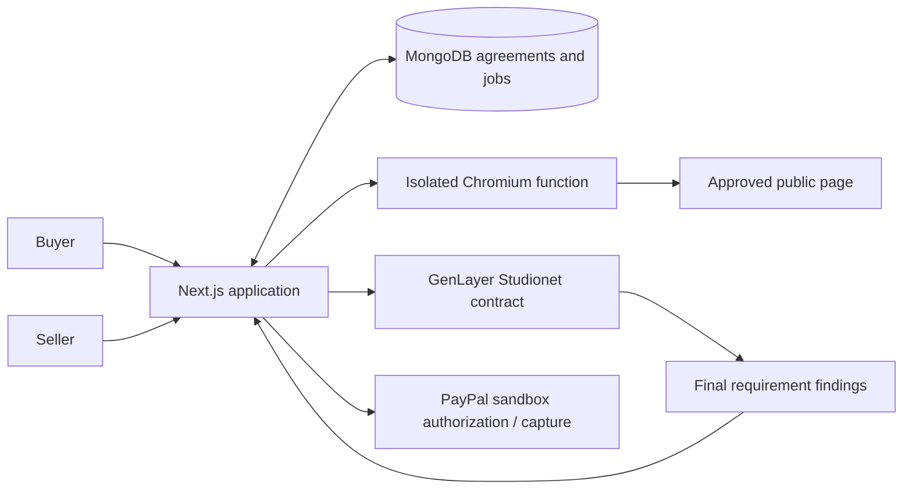

# RevisionPay

Agree on a website revision, verify the delivered version, and collect the authorized PayPal payment when the agreed conditions are met.

[Open RevisionPay](https://revisionpay.vercel.app) · [Source repository](https://github.com/TS-mfon/revisionpay)

RevisionPay connects **PayPal sandbox authorizations and capture** with **GenLayer Studionet Intelligent Contracts**. A seller freezes 3–5 requirements for one public page and a fixed USD fee. The buyer accepts those terms and authorizes payment. The app captures the delivered page; GenLayer evaluates each requirement against immutable text and link evidence. A successful finalized PASS and a fresh matching page permit one full capture. An incomplete or uncertain revision remains uncharged. Buyers can request review or explicitly accept a captured revision themselves.

This is a single-merchant hackathon prototype. All provider money calls are pinned to PayPal sandbox. Studionet is a development environment. The public **Demo simulation** uses deterministic fixtures for both payments and verification, clearly labeled throughout the interface; it is useful for trying the workflow without accounts but is not proof of a PayPal or blockchain transaction.

## Run locally

Requires Node.js 24 and pnpm 10.34.9.

```bash
corepack enable
pnpm install --frozen-lockfile
pnpm run setup
pnpm dev
```

Open <http://localhost:3000> and choose **Try the working demo**. `pnpm run setup` generates local secrets and a dedicated Studionet key without overwriting an existing `.env.local`. Use `pnpm run setup`, not the unrelated `pnpm setup` command.

The default `REVISIONPAY_MODE=demo` uses a local file under `.local/`. For local simulation, leave `MONGODB_URI` blank and set `APP_URL=http://localhost:3000`. Vercel deployments and sandbox operation require MongoDB. Keep `.env.local` private.

### The demonstration

1. Freeze the Northstar agreement and switch to buyer view.
2. Accept the terms and simulate the **$180 revision fee** authorization.
3. Switch to seller view. Select the incomplete page and submit it.
4. R2 fails: the page introduces an annual commitment and a $99 termination fee. The charged amount stays **$0**.
5. Select the corrected page and submit again. All requirements pass; after finality and a matching fresh capture, the simulated fee is collected once.
6. Inspect the evidence, activity, and downloadable receipt.

The page's **$29/month product price** is separate from the **$180 revision fee**. The verifier never chooses the payment amount. Additional fixtures demonstrate ambiguity, instructions embedded in page content, and content changed after review.

## Connect real sandbox services

Copy the settings in [.env.example](.env.example) into `.env.local` and supply:

| Setting | Purpose |
| --- | --- |
| `MONGODB_URI`, `MONGODB_DATABASE` | Atlas connection; database `revisionpay` |
| `PAYPAL_CLIENT_ID`, `PAYPAL_CLIENT_SECRET` | A PayPal sandbox REST app belonging to the seller |
| `PAYPAL_MERCHANT_ID` | Sandbox business merchant ID; `pnpm paypal:check` can discover it |
| `GENLAYER_PRIVATE_KEY` | Dedicated development relayer key generated by setup |
| `APP_URL` | Exact application origin, used for CSRF checks and payment return URLs |
| `CAPTURE_SERVICE_URL`, `CAPTURE_SECRET` | Isolated capture service and shared signing key |
| `CAPTURE_ALLOWED_HOSTS` | Exact approved website hosts, comma-separated |
| `SELLER_GITHUB_ID` | Numeric GitHub ID of the single authorized seller |
| `AUTH_SECRET`, `CRON_SECRET` | Random application and scheduler secrets |

Set `REVISIONPAY_MODE=sandbox`. The sandbox seller flow requires an approved HTTPS source host. The included Northstar template uses the hosted application's own domain.

```bash
pnpm db:indexes
pnpm paypal:check
pnpm studio:check
```

`paypal:check` verifies sandbox OAuth credentials. When the merchant ID is absent, it creates one **unapproved sandbox setup order** to discover the app's merchant. It does not authorize or capture money. `pnpm paypal:webhook` registers the hosted `APP_URL/api/webhooks/paypal` endpoint and saves its ID privately.

For an already-created free Atlas project and cluster, the optional connection helper creates a `readWrite@revisionpay` database user scoped to that cluster and saves its URI:

```bash
pnpm exec tsx scripts/atlas.ts YOUR_NEW_ATLAS_PROJECT_ID revisionpay
```

This helper also allows `0.0.0.0/0` on that project's network access list for Vercel's dynamic egress. Database authentication remains required. Use a dedicated sandbox project; do not point the helper at an unrelated database. A fixed-egress production deployment should narrow this network rule.

### Seller sign-in

The CLI sign-in path works without creating a GitHub OAuth application:

```bash
gh auth login
pnpm owner:login
```

The CLI checks the authenticated GitHub numeric ID against `SELLER_GITHUB_ID`, writes a 15-minute single-use login link to `.local/owner-login.html`, and stores only its hash. Open that file in your browser. The app's database and `APP_URL` must match the target deployment. Owner sessions last 12 hours.

Alternatively, configure `GITHUB_CLIENT_ID` and `GITHUB_CLIENT_SECRET` for a GitHub OAuth app with callback `APP_URL/api/auth/callback/github`. GitHub CLI authentication and application OAuth credentials are separate.

Buyers use the private invitation link. Keep it private; possession permits access to that agreement. It is single-use and establishes a browser session. Sandbox buyers approve using a **PayPal sandbox personal account**, separate from the seller's sandbox business account.

### GenLayer verification

The contract in [contracts/revision_agreement.py](contracts/revision_agreement.py) runs the AI assessment itself. The leader evaluates all frozen requirements; validators independently audit the conclusions and citations against the evidence. Page text is treated as untrusted data. The app validates identifiers, requirement coverage, citation IDs, aggregate verdict, transaction recipient, finality, and VM success before allowing automatic collection.

```bash
pnpm studio:smoke
```

This funds the dedicated key with development funds and deploys the actual contract on Studionet (chain 61999). It runs incomplete and corrected **synthetic evidence** through real Intelligent Contract execution and records transaction IDs in `.local/studio-smoke.json`. It makes no PayPal call. A successful run from November 5 is preserved in [docs/studionet-proof.json](docs/studionet-proof.json).

If a send times out, preserve its recorded transaction ID. Do not blindly rerun a mutation whose outcome is unknown. Contract execution may finalize with an error; finality alone is insufficient.

## Hosting on Vercel

Create two projects from this monorepo:

| Project | Root directory | Framework | Build |
| --- | --- | --- | --- |
| Application | `apps/web` | Next.js | `pnpm build` |
| Isolated capture | `apps/capture` | Other | `pnpm build`; bundled Node.js function at `/api/snapshot` |

Use Node 24 and `pnpm install --frozen-lockfile`. Enable source files outside the root directory so the workspace package and Python contract are included. The Next.js configuration explicitly traces the contract and excludes local credentials and data. The capture build emits a self-contained Build Output API function with bundled JavaScript and copied Chromium binaries; it does not deploy workspace symlinks.

Set the application variables above in the application project's **production** environment. Set only `CAPTURE_SECRET`, `CAPTURE_ALLOWED_HOSTS`, and `CAPTURE_ALLOW_LOCALHOST=false` on the capture project. The capture process must not receive PayPal credentials, Atlas credentials, or the relayer key.

Use the application's stable production domain as `APP_URL` and as an allowed capture host. Use the capture project's stable domain for `CAPTURE_SERVICE_URL`. Register the PayPal webhook after the application URL is set. Preview deployments pause settlement automatically.

### Background jobs and cost

Each agreement has a durable MongoDB job. Requests use Next.js `after()` to perform a bounded step; refreshing the agreement advances due work. MongoDB leases prevent competing workers from owning the same job and preserve wakeups requested during an active lease.

The included [GitHub Actions scheduler](.github/workflows/resume-jobs.yml) calls the authenticated worker endpoint every five minutes. Configure repository variable `REVISIONPAY_APP_URL` and secret `REVISIONPAY_CRON_SECRET`. Scheduled Actions can be delayed; payment deadlines are checked again at the moment of capture. The daily Vercel cron is a fallback compatible with Hobby. On Vercel Pro, change its schedule to `* * * * *` for faster unattended progress. This keeps the prototype deployable on the existing free account and leaves the agreed $50 ceiling available for optional upgrades.

The code permits at most two simultaneous workers, 20 new verifications daily by default, ten active seller agreements, and three submissions per agreement. `SETTLEMENT_PAUSED=true` blocks new collection; `NEW_JOBS_PAUSED=true` blocks new agreements and new verification sends. Reconciliation remains available.

## Tests

```bash
pnpm exec playwright install --with-deps --no-shell chromium
pnpm typecheck
pnpm test
pnpm build
pnpm test:e2e
```

The tests cover evidence hashing and bindings, finality and VM failures, buyer consent and holds, deadlines, competing capture attempts, lost provider responses, pending captures, tenant isolation, PayPal order validation, MongoDB compare-and-swap and lease recovery, and actual isolated Chromium capture. Playwright exercises the complete simulated flow through an uncharged failed revision, one completed payment, and a responsive receipt. Tests use a temporary MongoDB process and local data; they do not charge PayPal or send GenLayer transactions.

Linux capture tests need Chromium runtime libraries; `playwright install --with-deps` installs them on supported systems. The production collector uses `@sparticuz/chromium` packaged for Vercel's runtime.

## Architecture and limits



- The database stores a versioned agreement aggregate so consent, holds, current evidence, and payment reservations update atomically. A capture intent is saved before contacting PayPal. An unknown outcome blocks a second capture while provider reads reconcile it.
- Baseline and revision artifacts are immutable; a separate content hash permits comparing captures without timestamp differences. The collector includes visible page text outside `<main>` so contradictory footer terms are not silently omitted. It rejects private addresses, unsupported URLs, unapproved hosts, and incomplete critical-resource loads.
- The application controls page capture. GenLayer validates the submitted evidence; it does not independently attest that the browser captured every possible visitor experience. Different cookies, geolocation, delayed content, and a page changing after the final check remain limitations. Scope is visible copy and link targets, not legal compliance, visual design, or complete website functionality.
- The seller has 48 hours after authorization to submit; capture must start before 70 hours and the provider expiry. An expired uncollected authorization is voided where possible. Uncertain provider outcomes remain blocked for reconciliation.
- Buyer acceptance is an explicit alternate basis for payment, bound to a particular evidence artifact. It does not rewrite the verifier's findings as PASS.
- Unknown contract sends and interrupted order creation require operator investigation. Keep transaction/request IDs and use provider records; do not fabricate a receipt or reset payment state to force a retry.
- This version has one sandbox merchant, USD $25–$500 agreements, and no platform commissions, merchant onboarding, split payments, or automated refund initiation. It is not a production escrow service.

The original [build plan](BUILD_PLAN.md), [backlog](IMPLEMENTATION_BACKLOG.md), and [research](RESEARCH_AND_FEASIBILITY.md) explain the product rationale and original delivery assumptions. The implementation uses custom CSS, Studionet, and aggregate database documents; this README describes the running architecture.

## License

[MIT](LICENSE). The fictional Northstar website and interface are part of this repository. DM Sans is distributed under the [SIL Open Font License](apps/web/public/fonts/OFL.txt).
